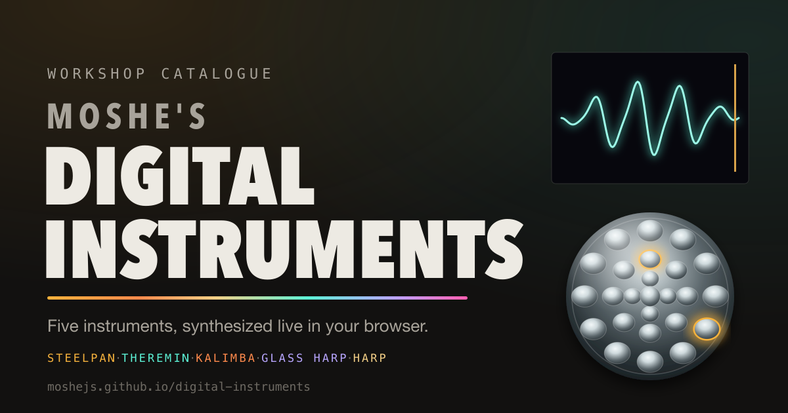
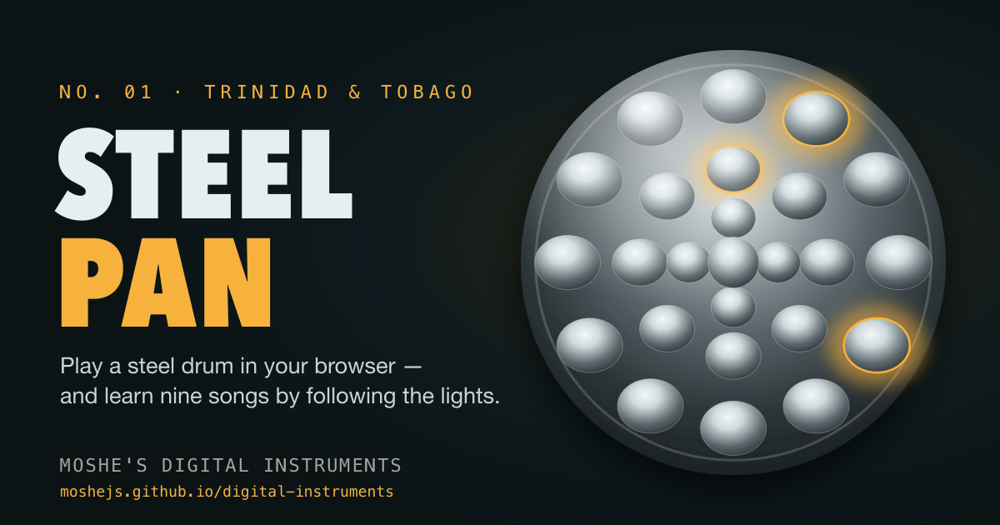
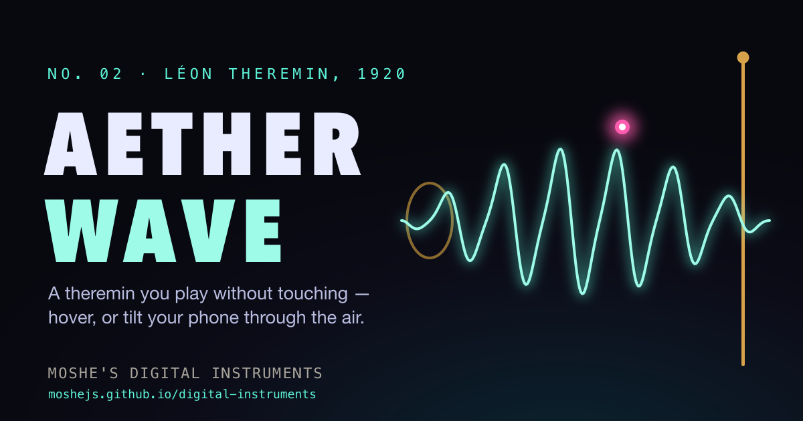
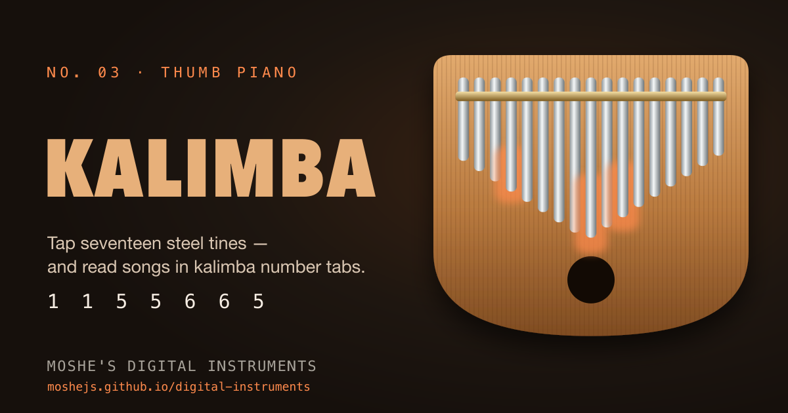
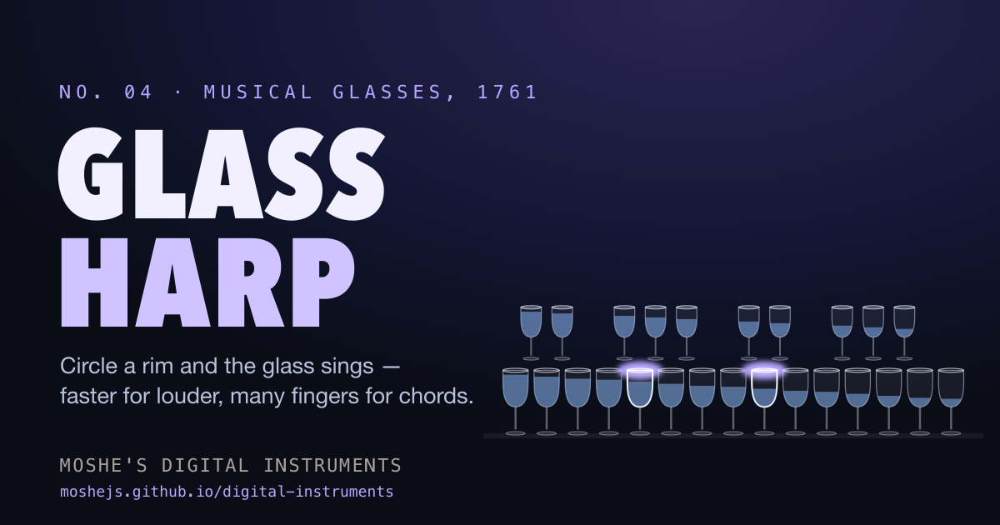
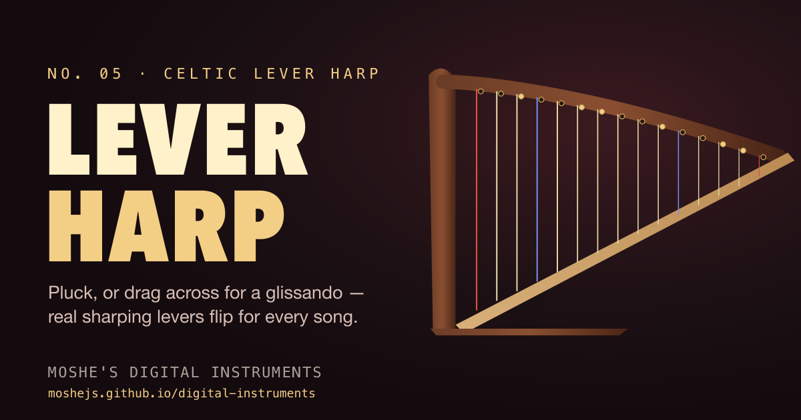

# Moshe's Digital Instruments



Five real instruments, synthesized note by note in your browser. No samples, no installs, no plugins — just the Web Audio API and the physics of each instrument.

**▶ Play now: [moshejs.github.io/digital-instruments](https://moshejs.github.io/digital-instruments/)**

| | | |
|---|---|---|
| [](https://moshejs.github.io/digital-instruments/steelpan/) | [](https://moshejs.github.io/digital-instruments/theremin/) | [](https://moshejs.github.io/digital-instruments/kalimba/) |
| **[No. 01 — Steelpan](https://moshejs.github.io/digital-instruments/steelpan/)**<br>Strike 25 chrome pads in the authentic circle-of-fifths layout. | **[No. 02 — Theremin "Aetherwave"](https://moshejs.github.io/digital-instruments/theremin/)**<br>Play without touching — hover, or tilt and shake your phone. | **[No. 03 — Kalimba](https://moshejs.github.io/digital-instruments/kalimba/)**<br>Tap or sweep 17 steel tines; read real kalimba number tabs. |
| [](https://moshejs.github.io/digital-instruments/glass-harp/) | [](https://moshejs.github.io/digital-instruments/harp/) | |
| **[No. 04 — Glass Harp](https://moshejs.github.io/digital-instruments/glass-harp/)**<br>Circle a rim to make a glass sing; faster is louder, many fingers make chords. | **[No. 05 — Lever Harp](https://moshejs.github.io/digital-instruments/harp/)**<br>Pluck or drag for glissandos; sharping levers flip themselves for each song. | |

## The instruments

| | How you play | How it sounds |
|---|---|---|
| **Steelpan** | Click, tap or a piano-style keyboard | Seven additive partials — a hand-detuned octave and twelfth — over a band-passed noise strike |
| **Theremin** | Hover for pitch and volume; on phones, roll / tilt / shake (gyroscope + accelerometer) | Two crossfaded oscillators, a vibrato LFO and portamento glide, with a live oscilloscope |
| **Kalimba** | Tap or sweep tines; keys `1`–`7`, `Q`–`U`, `A S D` | Clamped-tine cantilever modes at 1 : 6.27 : 17.55, a thumb click and a wooden-box resonance |
| **Glass Harp** | Press and circle a rim (speed = loudness), multi-touch chords, or hold keys | Glass bending modes with a detuned twin for shimmer, plus band-passed friction noise |
| **Lever Harp** | Pluck, drag across to strum, keys `1`–`7`, `Q`–`U`, `I`; `Shift`+key flips a lever | Karplus–Strong plucked strings with a soundboard resonance; E♭ tuning with sharping levers |

## Learning songs

- 🎵 **Nine public-domain songs** — Twinkle Twinkle, Mary Had a Little Lamb, Ode to Joy, When the Saints Go Marching In, Amazing Grace, Oh! Susanna, Greensleeves, Scarborough Fair and Londonderry Air (Danny Boy).
- ▶ **Listen** plays the tune; ◎ **Play Along** lights the next pad, tine, glass or string (or sweeps a target across the theremin and scores how long you stay on pitch).
- 🔗 **Deep links** — `/harp/?song=greensleeves` opens an instrument with a song ready.
- Each instrument only offers songs it can really play: the C-major kalimba explains which ones need sharps or flats. The harp sets its levers for each song's key and flips them mid-song when a melody needs it (Greensleeves uses both G and G♯).

Every melody was transcribed, then independently re-derived note by note by a second pass that corrected errors before they shipped.

## Development

Requires Node.js 22.12 or newer (`.nvmrc` pins 24).

```bash
npm install
npm run dev        # http://localhost:4321/digital-instruments/
npm run check      # strict TypeScript + Astro diagnostics
npm test           # Vitest unit tests
npm run build      # static site in dist/
npm run icons      # regenerate favicons, app icons and social cards
```

### Project layout

```
src/
  data/        songs.ts (shared songbook) · instruments.ts (catalogue, structured data) · availability.ts (which songs fit which instrument)
  lib/         music.ts · keyboard.ts · steelpan-layout.ts · theremin-field.ts · kalimba-layout.ts · glass-layout.ts · harp.ts (levers + geometry) · audio.ts · site.ts
  scripts/     one engine per instrument · shared/guide-player.ts (Listen / Play Along) · shared/song-ui.ts
  components/  SiteNav · SongPanel · InstrumentFooter
  layouts/     Base.astro — SEO, Open Graph, Twitter cards, JSON-LD, icons
  pages/       index · steelpan · theremin · kalimba · glass-harp · harp · 404
  styles/      instrument.css (shared shell + panel, themed by tokens) · one stylesheet per instrument
scripts/       generate-images.mjs — renders every icon and social card from the same layout code
tests/         note math, songbook, layouts, availability and harp lever logic
```

### Adding an instrument

1. Add its layout/logic to `src/lib/` and its slug to `InstrumentSlug` and `canPlay` in `src/data/availability.ts`.
2. Add catalogue metadata to `src/data/instruments.ts`.
3. Write an engine in `src/scripts/` and call `mountGuide(slug, host, copy)` — the `GuideHost` only needs `unlock`, `perform` and `showTarget`.
4. Create `src/pages/<slug>.astro` with `SongPanel` and `InstrumentFooter`, and a stylesheet that sets the shared colour tokens.
5. Draw its favicon and card in `scripts/generate-images.mjs`, then `npm run icons`.

### SEO and sharing

Per-page titles, descriptions, canonical URLs and keywords; Open Graph and Twitter cards with 1200×630 images; schema.org JSON-LD (`WebSite`, `WebApplication`, `BreadcrumbList`, `ItemList`); a sitemap, `robots.txt`, per-instrument SVG favicons, PNG/ICO fallbacks, an Apple touch icon and an installable web manifest with shortcuts to each instrument.

### Deployment

Pushing to `main` runs `.github/workflows/deploy.yml`: type-check → test → build → deploy to GitHub Pages. Pull requests run the same checks without deploying.

## License

[MIT](LICENSE) © 2026 Moshe Malka. All melodies are in the public domain.
